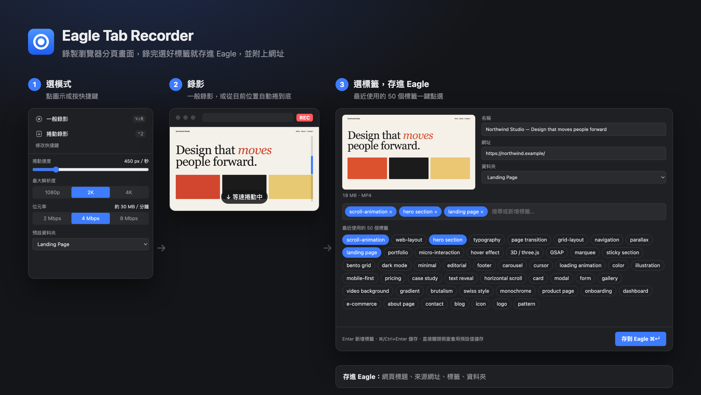
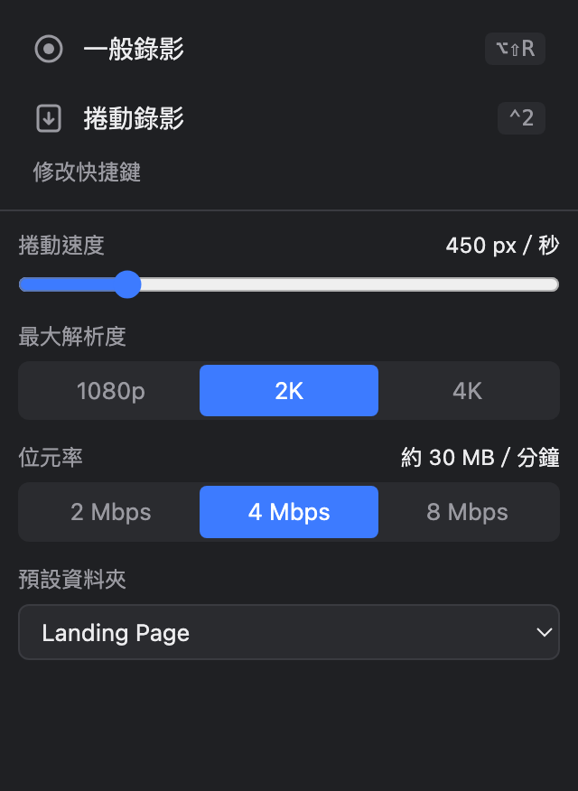
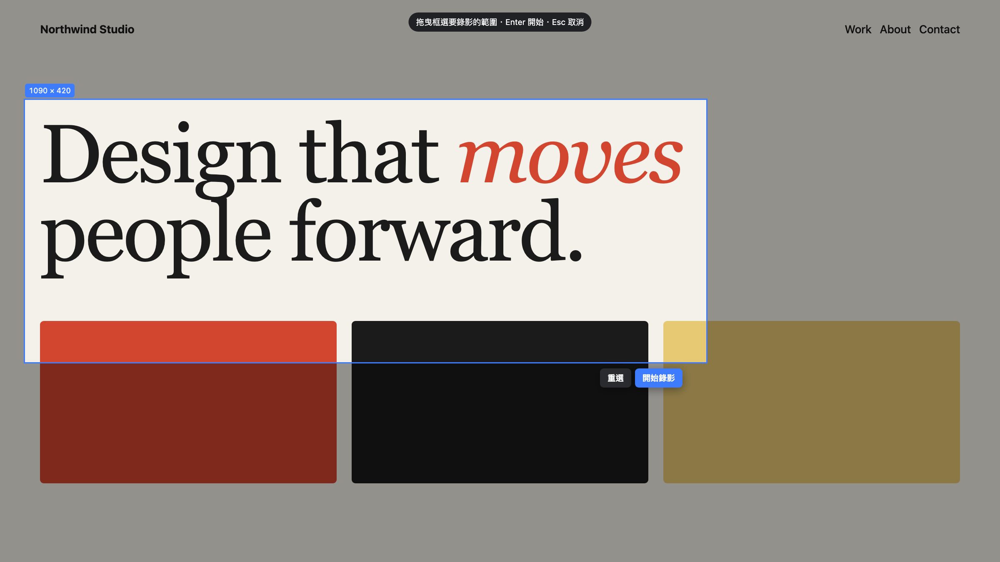
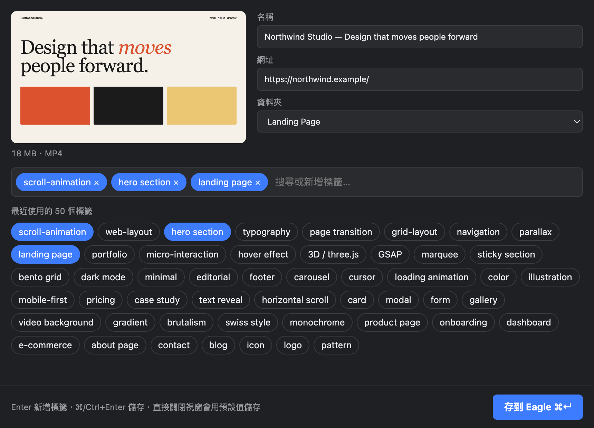

# Eagle Tab Recorder

錄製瀏覽器分頁畫面，錄完自動存進 [Eagle](https://eagle.cool/)，並附上網頁標題和網址。支援 Chrome 和 Edge。



## 功能

- **點圖示開選單**：選擇一般、捲動或範圍錄影，並顯示目前設定的快捷鍵；錄影參數也直接在選單裡調整。
- **一般錄影**：開始後再按一次快捷鍵，或打開選單按「停止」結束。
- **捲動錄影**：從目前畫面的位置開始，以固定速度往下捲，同時錄影。捲到底部時自動停止並存檔，也可以再按一次快捷鍵提前結束。
- **範圍錄影**：在網頁上拖曳框選一塊範圍，只錄那個範圍。錄影中範圍外圍會顯示紅色虛線框（不會被錄進去）。
- 錄完自動匯入 Eagle，名稱是網頁標題，來源網址是錄影時的網址。
- 錄完自動跳出分類視窗：預覽影片、修改名稱和網址，並從 Eagle 最近使用的 50 個標籤點選，也能搜尋或新增標籤、選擇資料夾。按 ⌘/Ctrl+Enter 儲存；直接關閉視窗會用預設值儲存，影片不會遺失。
- 輸出 MP4（H.264），預設最大 2K（2560×1440）、位元率 4 Mbps，都可以在選單調整。瀏覽器不支援 MP4 時改用 WebM。
- 會錄到分頁的聲音，錄影時你也聽得到。

## 安裝

1. 下載或 clone 這個 repo，資料夾請保留在電腦上，瀏覽器會直接從這裡載入。
2. 打開擴充功能頁面：
   - Chrome：`chrome://extensions`
   - Edge：`edge://extensions`
3. 開啟「開發人員模式」。
4. 點「載入未封裝項目」（Edge 是「載入解壓縮」），選這個資料夾。
5. 在工具列的拼圖圖示裡把 Eagle Tab Recorder 釘選到工具列。

使用前請先開啟 Eagle。

## 使用



| 動作 | 方式 |
|---|---|
| 開始一般錄影 | 點工具列圖示 →「一般錄影」，或按 `Alt+Shift+R` |
| 開始捲動錄影 | 點工具列圖示 →「捲動錄影」，或按 `Control+2`（Mac）／`Alt+Shift+S`（Windows） |
| 開始範圍錄影 | 點工具列圖示 →「範圍錄影」，或按 `Control+3`（Mac）／`Alt+Shift+A`（Windows），接著在網頁上拖曳框選，按「開始錄影」或 Enter 開始；Esc 取消 |
| 結束錄影 | 再按一次同一組快捷鍵，或點工具列圖示 →「停止並存到 Eagle」；捲動錄影捲到底部也會自動結束 |
| 調整設定 | 點工具列圖示，選單下半部就是設定 |

圖示上的標記：

- **REC**：錄影中
- **…**：處理中（存檔、匯入 Eagle）
- **✓**：已存進 Eagle
- **ERR**：發生錯誤，滑鼠移到圖示上可以看到原因

快捷鍵可以在選單裡按「修改快捷鍵」，或到 `chrome://extensions/shortcuts`（Edge 是 `edge://extensions/shortcuts`）修改。

### 範圍錄影

拖曳框出要錄的範圍，框旁會顯示尺寸；按「開始錄影」或 Enter 開始，「重選」可以重新框，Esc 取消。



### 分類視窗

錄完會自動跳出分類視窗，點選標籤、確認名稱和資料夾後按 ⌘/Ctrl+Enter 存進 Eagle。



## 設定

都在點圖示跳出的選單裡，改了馬上儲存，下一次錄影生效。

- **捲動速度**：每秒捲動幾個像素，100～2000，預設 450。
- **最大解析度**：1080p／2K／4K，預設 2K。分頁畫面比上限小時照原尺寸錄。
- **位元率**：2／4／8 Mbps，預設 4 Mbps，旁邊會顯示每分鐘大約幾 MB。
- **預設資料夾**：列出 Eagle 目前的資料夾，分類視窗會預先選好這個資料夾。

## 運作方式

1. 用 `chrome.tabCapture` 取得分頁畫面，在 offscreen document 裡用 `MediaRecorder` 錄影。
2. 錄完先存到「下載/eagle-recorder/」。
3. 透過 Eagle 本機 API（`http://localhost:41595/api/item/addFromPath`）匯入 Eagle。

捲動錄影會在網頁裡注入一段腳本，從目前位置開始用 `requestAnimationFrame` 以固定速度捲動。如果網頁本身不捲動，而是內層容器在捲，會自動找畫面上最大的可捲動區塊。到底後會多等 1.5 秒，讓延遲載入的內容有時間出現。

## 已知限制

- 只錄分頁內容，不含網址列和瀏覽器介面。
- `chrome://`、`edge://` 等瀏覽器內建頁面不能錄。
- 無限捲動的頁面不會自己停，請手動結束。
- 範圍錄影的範圍固定在畫面上的位置；錄影中捲動網頁，錄到的是捲過該位置的內容。錄影中改變視窗大小，範圍會跟著比例縮放。
- 「下載/eagle-recorder/」裡的檔案匯入後會保留，可以自行刪除。
- Eagle 如果要求 API token，請在擴充功能的 service worker console 執行：
  ```js
  chrome.storage.local.set({ token: '你的 token' })
  ```
